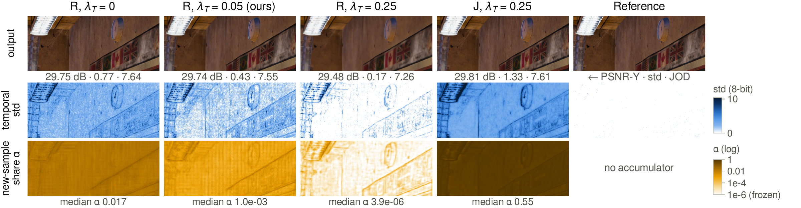
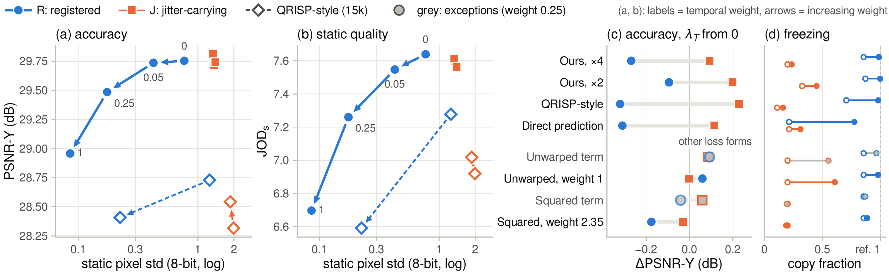
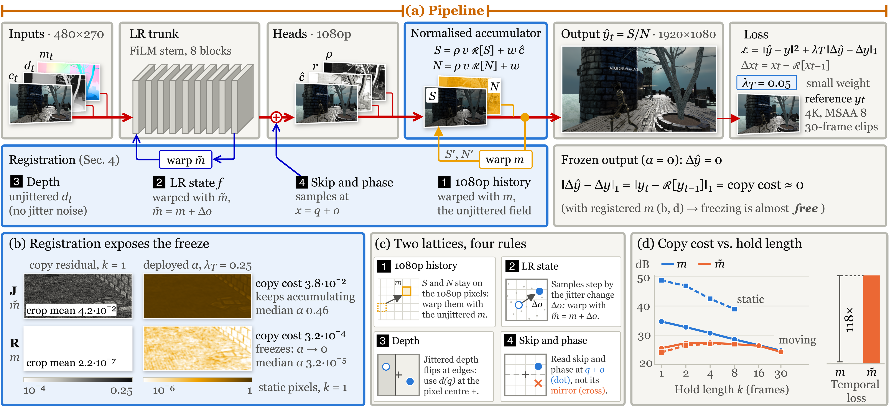
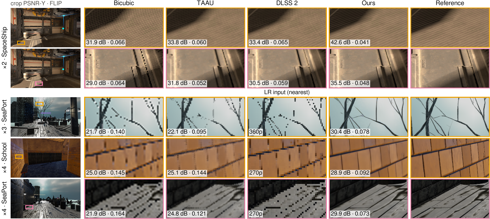
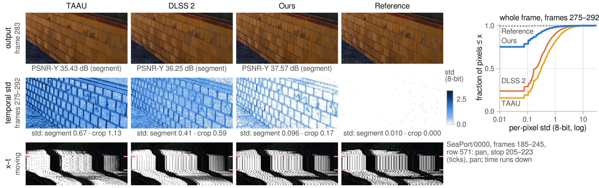

# Frozen History

Official implementation of **Frozen History: When Temporal Losses Stop Accumulation in Learned Real-Time Supersampling**.

[Method](#method) · [Results](#results) · [Getting started](#getting-started) · [Datasets](docs/DATASETS.md) · [Experimental protocol](docs/PROTOCOL.md) · [Configurations](docs/CONFIGURATIONS.md)



On a static view, a large temporal-loss weight can make a registered network copy its history and stop taking in new samples. The output flickers less, but loses detail. In this ×4 experiment, R uses correct registration and J uses the misregistered pipeline. The light regions in the bottom row indicate little contribution from the newest sample. See [Figure 1 at full resolution](assets/figures/teaser.png).

## Overview

Learned supersampling reconstructs a high-resolution frame from jittered low-resolution samples gathered over time. Temporal consistency losses reduce flicker, but their effect depends on how those samples are registered. With accurate registration, copying static history has almost no temporal cost. Increasing the loss weight can therefore suppress accumulation and reduce reconstruction quality.

The paper studies this behavior through a model-free copy-cost analysis and controlled experiments across network families, scales and loss forms. It also presents a registered network with a normalized sample accumulator and a small temporal weight, evaluated on QRISP, Arm Bistro and STSS.

This repository includes models, training and evaluation code, dataset converters, experiment configurations and optional CUDA/Triton kernels. The figures and numerical results below come from the paper. The release tests use synthetic inputs; full training, paper metrics and H200 timings have not been rerun during release validation. Datasets and trained checkpoints are not bundled.

## Why temporal weight can stop accumulation



With correct registration, increasing the warped L1 temporal weight reduces static variation while lowering PSNR and static ColorVideoVDP quality. With the misregistered pipeline, the same loss has a different effect. The registered model-free copy cost is 118 times smaller on static pixels, which makes unchanged history inexpensive under the loss. [View Figure 3 at full resolution](assets/figures/temporal-loss.png).

Selected results from paper Table 1 show the PSNR-Y change when the temporal weight increases from 0 to 0.25:

| Model | Scale | J: static ΔPSNR | J: moving ΔPSNR | R: static ΔPSNR | R: moving ΔPSNR |
| --- | --- | ---: | ---: | ---: | ---: |
| Normalized accumulator | ×4 | +0.11 dB | +0.10 dB | -0.86 dB | -0.24 dB |
| Normalized accumulator | ×2 | +0.23 dB | +0.20 dB | -0.68 dB | -0.05 dB |
| QRISP-style network | ×4 | +0.31 dB | +0.23 dB | -0.85 dB | -0.30 dB |
| Direct prediction | ×4 | +0.12 dB | +0.12 dB | -0.70 dB | -0.29 dB |

Each change is relative to the same network and registration pipeline at zero temporal weight. Static and moving scores are frame means over 97 and 1,363 frames. Runs use 45,000 training updates, except the QRISP-style comparison, which uses 15,000. R and J differ in the complete registration pipeline; the model-free experiment isolates the motion convention.

## Method



The low-resolution network predicts candidate color, reliability and history retention. A normalized accumulator keeps a weighted color sum and its accumulated weight on the output lattice. The low-resolution recurrent state follows the moving sample lattice, while the output history follows the fixed display lattice.

The implementation corrects four buffer conventions:

1. Use unjittered motion for high-resolution output history.
2. Include the change in sample offset when warping low-resolution state.
3. Use unjittered depth for the registered geometry convention.
4. Read the skip path and phase at the registered sample positions.

The final QRISP configurations use a temporal weight of 0.05. [View Figure 2 at full resolution](assets/figures/pipeline.png), or read the [geometry and training protocol](docs/PROTOCOL.md).

## Results

### Reconstruction at ×2, ×3 and ×4



The figure shows selected detailed regions from the paper, with crop PSNR-Y and FLIP. These crops were chosen for high reconstruction gains and are not test-set averages. At ×3 and ×4, the third comparison column shows the nearest-neighbor low-resolution input because the dataset supplies no DLSS captures at those scales. [View Figure 4 at full resolution](assets/figures/reconstruction.png).

Selected test-set results from paper Table 2:

| Scale | Method | PSNR-Y ↑ | SSIM-Y ↑ | LPIPS ↓ | FLIP ↓ | JOD ↑ |
| --- | --- | ---: | ---: | ---: | ---: | ---: |
| ×2 | Ours, 192×8 | **32.69** | **0.9246** | **0.091** | **0.0570** | **8.61** |
| ×2 | QRISP-L † | 32.21 | 0.9115 | N/A | N/A | N/A |
| ×2 | DLSS 2, supplied captures | 30.12 | 0.8821 | 0.151 | 0.0732 | 8.22 |
| ×2 | TAAU | 29.99 | 0.8740 | 0.162 | 0.0743 | 7.99 |
| ×3 | Ours, 192×8 | **31.01** | **0.8899** | **0.140** | **0.0697** | **8.14** |
| ×3 | QRISP-L † | 30.67 | 0.8747 | N/A | N/A | N/A |
| ×3 | TAAU | 28.59 | 0.8299 | 0.233 | 0.0876 | 7.36 |
| ×4 | Ours, 256×8 | **30.04** | **0.8635** | **0.175** | **0.0801** | **7.77** |
| ×4 | QRISP-L † | 29.42 | 0.8403 | N/A | N/A | N/A |
| ×4 | TAAU | 27.61 | 0.7938 | 0.295 | 0.0997 | 6.82 |

† QRISP-L values are published baseline scores quoted in the paper. Other rows use the paper's evaluation harness. PSNR-Y is in dB. Every scale reconstructs 1920×1080 output. Evaluation resets history for each of five camera sequences and omits eight warm-up frames per sequence, leaving 1,460 scored frames. PSNR and SSIM use equal scene weights across three scenes. The final models train for 100,000 updates at ×2/×3 and 200,000 at ×4. Full metric settings are in [PROTOCOL.md](docs/PROTOCOL.md).

### Temporal behavior



At ×2 on the 18-frame School stop, the final model has a mean pixel standard deviation of 0.096, compared with 0.41 for DLSS 2, and static PSNR-Y of 37.57 dB, compared with 36.25 dB. The bottom row shows a SeaPort space-time slice across a camera pan, stop and second pan. Pixel variation alone can reward freezing, so the paper reports reconstruction and perceptual scores alongside it. [View Figure 5 at full resolution](assets/figures/temporal-stability.png).

### Quality and latency

Selected ×4 variants from paper Table 2:

| Model | Training configuration | PSNR-Y ↑ | Recurrent step ↓ |
| --- | --- | ---: | ---: |
| 256×8 convolutional | [qrisp_x4](configs/train/qrisp_x4.json) | 30.04 dB | 2.032 ms |
| 96×4 reparameterized | [rep_96x4](configs/train/rep_96x4.json) | 29.49 dB | 0.524 ms |
| 64×4 reparameterized | [rep_64x4](configs/train/rep_64x4.json) | 29.32 dB | 0.332 ms |
| 64×6 shift-MLP | [shift_64x6](configs/train/shift_64x6.json) | 29.32 dB | 0.201 ms |

Timings use one NVIDIA H200, batch 1, 1080p output, fused kernels, bf16 with fp32 accumulation and a CUDA graph. They average 300 calls after 50 warm-ups and include input preparation, warps, the network and accumulation. Rendering is excluded. These are hardware-specific paper measurements.

## Getting started

The [step-by-step guide](docs/GETTING_STARTED.md) covers CPU and CUDA installation, data preparation, short setup checks, full training, checkpoint recovery and troubleshooting. Use Linux and Python 3.12 for paper experiments. Run commands below from the repository root.

```bash
git clone https://github.com/CV-AC/Frozen_history.git
cd Frozen_history
```

### Install and check

For the CPU test suite on Linux:

```bash
python3.12 -m venv .venv
source .venv/bin/activate
python -m pip install --upgrade pip
python -m pip install torch==2.10.0 torchvision==0.25.0 --index-url https://download.pytorch.org/whl/cpu
python -m pip install -r requirements-dev.txt
python -m pip install -e . --no-deps
python -m pip check
python -m pytest -q
```

For GPU training, install a compatible CUDA PyTorch wheel instead of the CPU wheel; see [environment setup](docs/GETTING_STARTED.md#1-choose-an-environment). Install `requirements-metrics.txt` for LPIPS, FLIP and ColorVideoVDP, and `requirements-cuda.txt` for fused CUDA/Triton deployment. LPIPS may download its external metric weights on first use.

### Prepare QRISP

Obtain the provider files and arrange them as described in [DATASETS.md](docs/DATASETS.md), then pack the data:

```bash
export FROZEN_HISTORY_DATA="$PWD/data"
export QRISP_RAW="$FROZEN_HISTORY_DATA/qrisp/raw"
export QRISP_LMDB="$FROZEN_HISTORY_DATA/qrisp/lmdb"
python scripts/pack_qrisp.py --splits train --tile-grid 2x4
python scripts/pack_qrisp.py --splits test
python scripts/validate_qrisp.py --scene CBApocalypse --res 270p
```

Training uses tiled LMDBs; full-sequence evaluation uses untiled test LMDBs. Keep the shared camera metadata under `270p/CameraData` for all scales. Do not use `--allow-incomplete` for paper experiments.

### Train, infer and evaluate

```bash
python scripts/train.py --config configs/train/qrisp_x4.json --dry-run
python scripts/train.py --config configs/train/qrisp_x4.json
python scripts/inference.py --run runs/qrisp_x4 --out results/predictions
python scripts/protocol_full.py qrisp_x4 --scale 4 --warmup 8 --lpips --out results/qrisp_x4.json
python scripts/static_segment.py qrisp_x4 --scale 4 --out results/qrisp_x4_static.json
python scripts/metrics_graphics.py --method qrisp_x4 --scale 4 --out results/qrisp_x4_graphics.json
```

Use `qrisp_x2.json` or `qrisp_x3.json` for the other scales. Training writes `runs/<name>/config.json` and `last.pt`. Inference requires a trained checkpoint. To resume, first confirm that `last.pt` exists, then repeat the original command with `--resume` and the same settings.

### Run the mechanism experiment

```bash
python scripts/train.py --config configs/train/mechanism_r_l0.json
python scripts/train.py --config configs/train/mechanism_r_l025.json
python scripts/train.py --config configs/train/mechanism_j_l0.json
python scripts/train.py --config configs/train/mechanism_j_l025.json
python scripts/copy_fraction.py mechanism_r_l025 --scale 4 --out results/copy_fraction.json
python scripts/copy_cost.py --scales 4 3 2
```

The [configuration catalogue](docs/CONFIGURATIONS.md) also covers other loss weights, direct prediction, QRISP-style networks, registration components, STSS and deployment trunks. For Arm and STSS, follow the separate [data setup](docs/DATASETS.md) and [transfer protocols](docs/PROTOCOL.md).

### Validate and time deployment

After training the selected deployment model:

```bash
python scripts/validate_deployment.py --run runs/rep_64x4 --precision fp32 --out results/deployment_parity.json
python scripts/benchmark.py --run runs/rep_64x4 --mode graph --precision bf16 --out results/trained_latency.json
```

Fused graph execution supports registered ×4 normalized-accumulation variants. Use eager mode for other scales. Passing `--config` to the benchmark constructs random weights; passing `--run` loads a trained checkpoint.

## Repository layout

| Path | Contents |
| --- | --- |
| `diffsr/rrta.py`, `samples.py` | Recurrent model, registration and accumulation |
| `diffsr/qrisp_model.py` | Independently implemented QRISP-style comparison |
| `diffsr/engine_seq.py`, `checkpoint.py` | Sequence training, losses and checkpoint loading |
| `diffsr/data_*.py` | QRISP, STSS and Arm adapters |
| `diffsr/fast/`, `fast_blocks.py` | Optional fused kernels and convolution folding |
| `scripts/` | Conversion, training, inference, evaluation and diagnostics |
| `configs/` | Training, model and classical-baseline settings |
| `assets/figures/` | Paper figures used on this page |
| `docs/`, `tests/` | Setup, protocol, release records and synthetic tests |

## Release validation

The code release includes synthetic model and adapter tests, a training-to-inference integration test and an audit for private metadata, Python comments and docstrings. Optional perceptual tests skip when their packages are absent. See the [release record](docs/RELEASE.md) and [repository assessment](docs/OPEN_SOURCE_REVIEW.md) for completed checks and their limits.

The figures and tables on this page are selected from the paper; [MEDIA.md](docs/MEDIA.md) records their source figures, evaluation notes and attribution. The source package includes these five display figures, while excluding raw datasets, checkpoints, experiment outputs and manuscript files.

## License and citation

Project code is released under the [MIT license](LICENSE). Dataset terms, scene assets, supplied comparison captures and external metric-network licenses remain separate; see [THIRD_PARTY.md](THIRD_PARTY.md).

Use [CITATION.cff](CITATION.cff) when citing this code. This release uses contributor-group metadata and omits personal details.
